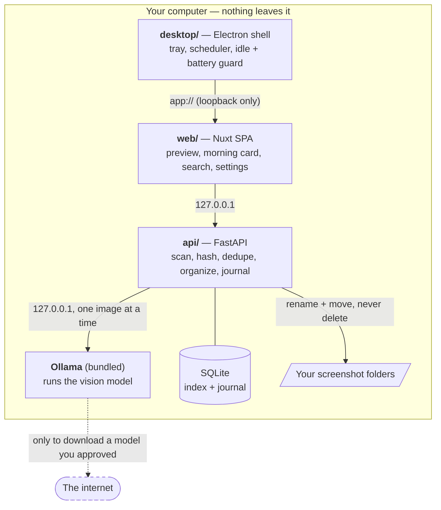

# Slothshot

**Sorts the screenshots piling up on your computer while you are not using it. Entirely offline, on Windows, macOS and Linux.**

You have hundreds of files called `Screenshot 2026-08-04 at 6.00.00 p.m..png`. You know one of them has the booking number. Finding it means opening them one at a time.

Slothshot reads each screenshot with an open-weight vision model running **on your own machine**, gives it a name you can recognise, files it by what it is, and leaves a Review pile for the duplicates and the things that have expired. It works overnight, while the laptop is idle and plugged in, and it gets out of the way the moment you come back.

Screenshots hold private chats, bank details and passwords. That is the whole reason this runs locally: **nothing is uploaded, ever.** The only time Slothshot touches the network is to download the model you chose.

---

## Before and after

A folder of 28 screenshots, sorted in 101 seconds on a MacBook Pro M2 Pro. This is real output, not an illustration.

**Before** — everything in one folder, every name useless:

```
Screenshot 2026-08-04 at 6.00.00 p.m..png
Screenshot 2026-08-06 at 11.56.00 a.m..png
Screenshot 2026-08-07 at 5.25.00 p.m..png
Screenshot 2026-08-08 at 3.24.00 p.m..png
Screenshot 2026-08-10 at 5.49.00 p.m..png
… 28 files
```

**After** — renamed by what they show, filed by what they are:

```
Slothshot/
├── code/
│   ├── 2026-08-22-hashing-code.png
│   └── 2026-09-30-uv-test-results.png
├── conversation/
│   └── 2026-08-26-messages-chat.png
├── design/
│   ├── 2026-08-25-design-rectangle-circle-button.png
│   └── 2026-09-09-brand-palette.png
├── document/
│   ├── 2026-08-07-operating-summary.png
│   ├── 2026-08-10-payment-details-credit-card.png
│   ├── 2026-08-12-order-confirmation.png
│   ├── 2026-10-06-everyday-account.png
│   ├── 2026-10-06-inbox-q3-handover-notes.png
│   └── 2026-10-09-invoice-investment.png
├── error message/
│   ├── 2026-08-06-error-message-disk-full.png
│   ├── 2026-08-15-bank-verification-code.png
│   ├── 2026-09-01-error-message.png
│   ├── 2026-09-08-vault-error-message.png
│   └── 2026-10-08-404-page-not-found.png
├── meme/
│   ├── 2026-08-27-circular-object.png
│   └── 2026-09-30-when-you-open-the-screenshots-folder.png
├── other/
│   ├── 2026-08-04-screenshot-naming.png
│   ├── 2026-08-12-weather-mexico-city.png
│   └── 2026-09-08-settings-general.png
├── receipt/
│   ├── 2026-09-06-northgate-market-grocery-receipt.png
│   └── 2026-09-11-casa-miranda-receipt.png
├── social media/
│   └── 2026-08-29-profile-juniper-blake.png
├── ticket or booking/
│   └── 2026-09-21-the-pale-fountains-ticket.png
└── Review/
    ├── 2026-08-08-boarding-pass.png                        ← the flight already departed
    ├── 2026-09-28-hashing-code.png                         ← a resized copy of another file
    └── 2026-09-28-northgate-market-grocery-receipt.png     ← a byte-identical copy
```

All 28 files, nothing hidden — including the ones it got wrong. The credit-card form and the
bank balance landed in `document`, and the password vault in `error message`. That is the 75%
accuracy in the table below, visible rather than described. Every one of them was still
correctly flagged **sensitive**, which is the part that matters: their text was never stored.

Then the morning card says: **28 sorted. 3 items waiting in Review. Deleting them yourself would free 65 KB.**

> Slothshot never deletes anything. That last line is information, not an offer.

---

## Install

The installers are **unsigned on every platform**, because a signing certificate costs money this project does not have. Each operating system will warn you. Here is how to get past it, and what the warning actually means: the system cannot confirm who built the app, not that it found anything wrong with it.

### macOS (Apple Silicon)

1. Open `Slothshot-0.1.0-arm64.dmg` and drag Slothshot to Applications.
2. The first launch will be refused. **Right-click the app → Open**, then **Open** again in the dialog. Double-clicking will not work; the right-click route is what tells macOS you meant it.
3. If macOS still refuses: **System Settings → Privacy & Security**, scroll down, and click **Open Anyway** next to the message about Slothshot.

### Windows (x64)

1. Run `Slothshot-0.1.0-x64-setup.exe`.
2. SmartScreen will show **"Windows protected your PC"**. Click **More info**, then **Run anyway**.
3. The installer is per-user and does not ask for administrator rights.

### Linux (x64)

**AppImage** — one file, no installation:

```sh
chmod +x Slothshot-0.1.0-x86_64.AppImage   # AppImages arrive without the executable bit
./Slothshot-0.1.0-x86_64.AppImage
```

**Debian/Ubuntu/Mint:**

```sh
sudo apt install ./slothshot_0.1.0_amd64.deb
```

### Verify what you downloaded

Every release ships `SHA256SUMS`:

```sh
sha256sum -c SHA256SUMS      # Linux
shasum -a 256 -c SHA256SUMS  # macOS
```

---

## First launch

Slothshot bundles the Ollama engine but **no model weights** — that keeps the installer at a few hundred megabytes instead of several gigabytes, and it means you choose what runs on your machine.

On first launch the wizard shows the models it has actually been tested with, each with **what it will cost you before anything is downloaded**: the download size, the memory it needs and its license. Nothing is downloaded until you pick one.

While it downloads you get the size, the speed and a rough time remaining, and you can **pause and continue** — closing the app mid-download is offered again next time rather than resumed behind your back.

Then it runs a check that matters: **it renders a short token into a test image and requires the model to read it back.** The recommended list only holds vision models, but the wizard also lets you name any model in the Ollama library, and a text-only model asked to describe a picture will happily invent one. A model that cannot see has no way to produce the token, so it is refused instead of silently producing nonsense for every screenshot you own.

Cloud models are refused outright, by name and again after install. They would mean sending your screenshots to someone else's computer, which is the thing this app exists to avoid.

## The models

Measured on a MacBook Pro M2 Pro, 16 GB, over 28 screenshots covering all ten categories. Full method and per-image results in [docs/BENCHMARKS.md](docs/BENCHMARKS.md).

| Model | Download | Peak RAM | Per screenshot | Category accuracy | Sensitive missed | License |
| --- | --- | --- | --- | --- | --- | --- |
| **`qwen3-vl:2b-instruct`** (default) | 1.9 GB | **2.86 GB** | 3.6 s | 75% | **0** | Apache 2.0 |
| `gemma4:e4b` | 6.6 GB | 4.78 GB | 5.2 s | **89%** | **0** | Apache 2.0 |
| `gemma4:e2b` | 4.6 GB | 4.50 GB | 3.0 s | 71% | **1** | not offered |

**No model met every target, so Slothshot ships a choice instead of a verdict.** Exactly one configuration fits the 3 GB memory budget, and exactly one model clears the 85% accuracy gate. They are not the same one.

The default keeps the resource promise true. `gemma4:e4b` is offered for machines with memory to spare and sorts noticeably better.

`gemma4:e2b` is **not offered at all**: it missed a screenshot containing bank details. That is a safety property rather than a quality score, so a model that fails it is not a choice at any size.

All 168 measured inferences returned valid JSON — zero retries, zero unparseable answers — because the model is handed a JSON schema rather than asked politely for one.

---

## How it stays light

Peak resident memory during a full run, sampled every 250 ms:

| | Peak | Budget |
| --- | --- | --- |
| Ollama + model | **2.71 GB** | 3.00 GB ✓ |
| The api (FastAPI + Pillow) | 0.09 GB | — |
| Ollama once the run ended | **0.02 GB** | model released ✓ |

How that is achieved:

- **One image at a time.** No batching, no parallel requests. Ollama is held to one loaded model and one request.
- **Three gates before the model.** The folder walk skips anything that is not an image; a SHA-256 of the bytes settles exact duplicates without opening the file; a perceptual hash settles resized copies without the model. In the run above, 28 files became 27 rows and 26 model calls.
- **Images are downscaled to 768 px** before inference. Both candidate models scored *identically* at 768 and 1024, while 768 costs less memory — so nothing was bought by sending bigger images.
- **The model is unloaded the moment a run ends**, not after a keep-alive expires. Two gigabytes do not sit resident between runs.
- **Nothing is analysed twice.** Screenshots are keyed by the hash of their contents, so a file you rename or move yourself is still recognised.
- **Low priority.** The api and Ollama run below normal priority, so a run never competes with what you are doing.
- **It waits for you to leave.** Overnight by default, only while the machine is idle, only while plugged in. A run in flight pauses the moment you come back or the charger comes out, and resumes later.

Installers, all far under the 1.5 GB ceiling:

| Platform | Installer | Size |
| --- | --- | --- |
| macOS (Apple Silicon) | `.dmg` | 302.7 MB |
| Windows (x64) | NSIS `.exe` | ~165 MB |
| Linux (x64) | AppImage | 204.1 MB |
| Linux (x64) | `.deb` | 165.1 MB |

Windows and Linux ship Ollama's CPU and **Vulkan** backends and leave out CUDA and ROCm, which are about 1.3 GiB on their own. Vulkan runs on AMD, Intel and NVIDIA drivers, so one backend covers every machine, and the build fails if those folders survive or if Vulkan goes missing.

---

## Undo, and what is guaranteed

**Slothshot never deletes a file.** Not duplicates, not expired items, not anything. They move to `Review`, where you decide.

That is enforced by structure rather than by care: the module that moves files contains exactly two filesystem operations — create a directory, move a file. There is no delete, no overwrite and no truncate anywhere in it. The only removal in the entire codebase is a single `rmdir`, in undo, on a folder Slothshot created, and only when it is already empty.

**Every change is written down before it happens.** A journal row is committed, then the file moves, then the row is marked applied. A crash in between leaves a record that undo can check against the disk, rather than a move nobody recorded.

**Undo works at three levels** — one file, one run, or everything — and is **all-or-nothing**. Every change is verified against the filesystem first, and if any one of them cannot be reversed, nothing moves and you are told so. When Slothshot says *"Nothing was changed"*, that is literally true.

From the run above, undone completely:

```
restored 28 files
all back at the top level : True
same bytes, nothing lost  : True
Slothshot folder gone     : True
example restored name     : Screenshot 2026-08-04 at 6.00.00 p.m..png
```

Original names come back exactly, down to the narrow no-break space macOS puts before `p.m.`.

**Sensitive screenshots are sorted, but never indexed.** If a screenshot shows a password, a card number, bank details or a one-time code, its text is not stored at all — so it cannot be searched, and it cannot leak into a backup of the index. Searching for the verification code visible in a test screenshot returns nothing, because there is nothing to match. The description stays searchable, so you can still find it. You can turn indexing on in Settings if you want it.

---

## Architecture



Both the api and the bundled Ollama bind to `127.0.0.1` only. The desktop shell gives them a scrubbed environment, so your own `OLLAMA_*` settings cannot leak in, and uses its own bundled Ollama rather than a system-wide one.

| Path | What it is |
| --- | --- |
| `api/` | FastAPI, SQLModel/SQLite, Pillow. Scanning, hashing, duplicates, model calls, the journal |
| `web/` | Nuxt 4 SPA (`ssr: false`), served by the shell over `app://` |
| `desktop/` | Electron: bundles Ollama and the api, tray, scheduler, process-tree cleanup |
| `scripts/` | The build, run identically by `npm run dist` and by CI |
| `spike/` | The model benchmark, re-runnable on any machine |
| `docs/` | [DECISIONS.md](docs/DECISIONS.md) — every decision and why. [BENCHMARKS.md](docs/BENCHMARKS.md) — the numbers |

---

## Building it yourself

```sh
npm run dist          # the installer for this system, in desktop/release/
npm run dist -- --list
```

That runs the same scripts, in the same order, as [`.github/workflows/build.yml`](.github/workflows/build.yml). A test fails if the two ever drift apart, so a release can never be built by steps nobody ran locally.

```sh
cd api && uv sync && uv run pytest -q         # 167 tests
cd web && npm install && npm test             # 21 tests
cd desktop && npm install && npm test         # 77 tests
node --test "scripts/*.test.mjs"              # 8 tests
```

---

## Branching

`master` is production, `develop` is integration, and neither takes a direct commit. Every build step is one `feature/*` branch off the latest `develop`, one pull request based on `develop`, merged before the next step starts. No stacked pull requests. There is no branch named `main`, and a test in CI fails if a workflow ever refers to one.

Releases are `release/*` → `master`, tagged `vX.Y.Z`, and the tag workflow creates a **draft** release with the three platforms' installers and `SHA256SUMS`. Nothing is published automatically.

---

## Why open source matters here

**Because of what is in a screenshot.** Mine included a payment console showing a customer's email beside card fields, a password manager, and a bank balance. Sending those to an API to be described would be the single worst thing this app could do. A local open-weight model is not a cheaper way to build this — it is the only honest way.

**Because you can check.** The claim "nothing is uploaded" is worth exactly as much as your ability to verify it. Both services bind to loopback, the environment handed to them is scrubbed, cloud models are refused by name, and you can read all of it.

**Because it keeps working.** No account, no subscription, no API key to expire, no pricing change, no shutdown notice. It runs on a laptop with the Wi-Fi off.

**Because the model is yours to swap.** The tag is read from local settings and never hardcoded. A better small vision model next month is a one-line change, not a new release — and the benchmark that chose this one is in the repository, so you can run it on your own machine and disagree with the result.

**Because the honest answer was available.** No model met every target. A closed service would have shipped the number that flattered it. Here the measurements, the model that was rejected for missing bank details, and the gap between 75% and the 85% goal are all written down in [docs/BENCHMARKS.md](docs/BENCHMARKS.md).

---

## Status

Working: scanning, duplicates, the model pipeline, preview and approval, rename and move, Review, the journal and undo, search, the morning card, the tray, the scheduler, and installers for all three platforms.

Not yet:

- **75% category accuracy on the default model**, below the 85% goal. The misses cluster on `document` versus the more specific categories, and there are ~6 seconds per screenshot of unused headroom to spend on a better prompt. Written up in [docs/BENCHMARKS.md](docs/BENCHMARKS.md).
- **The Windows and Linux installers are built and smoke-tested in CI, but have not been installed on real machines.**

---

## Licenses

Slothshot is [MIT](LICENSE). Bundled components and their licenses are listed in [THIRD_PARTY_NOTICES.md](THIRD_PARTY_NOTICES.md): Electron (MIT, with Chromium's own notices), Ollama (MIT), Nuxt and Vue (MIT), FastAPI (MIT), Uvicorn (BSD-3-Clause), Pydantic and SQLModel (MIT), Pillow (MIT-CMU), psutil (BSD-3-Clause).

Model weights are **not** bundled. The model you choose carries its own license, shown before any download starts — Apache 2.0 for both recommended models.
